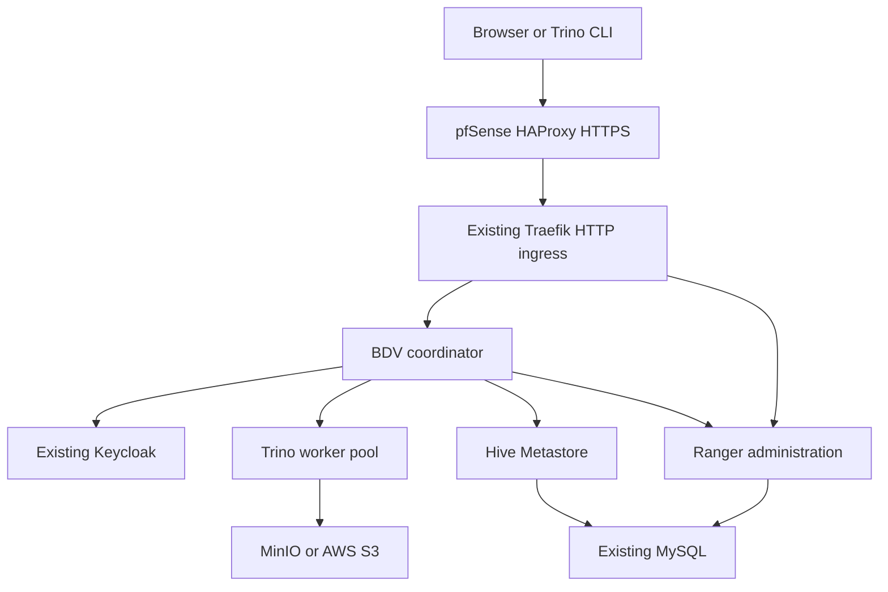

# BDV deployment kit 0.1.35

Deploy MDACA BDV/Trino, Hive Metastore, Apache Ranger and MinIO using an existing
MySQL server and an existing Keycloak realm. This kit supports a new installation
and migration of the tested `bdv` release without deleting its databases,
retained credentials, Ranger policies or object storage. Ranger SSO is excluded.

This version consolidates the earlier manual configuration into Helm values and
adds repeatable Ranger authorization, worker autoscaling and container-aware JVM
memory. The operator verified the isolated fresh-install and CPU scaling path
on the cluster. The packaging environment itself has no cluster connection.

Worker draining is opt-in. The user verified version 0.1.32 busy-worker draining and automatic scale-down from three to two, followed by a successful warehouse read. See [worker drain setup and test](docs/WORKER-DRAIN-032.md). The isolated fresh install, six-worker capacity and CPU scaling tests also passed; see the acceptance update below.

For an isolated fresh install and six-worker test, follow [bdv-test acceptance](docs/FRESH-TEST-033.md). The fresh-test wrapper always targets bdv-test.

See [image builds and original layers](docs/IMAGE-BUILDS.md) and the [implementation record](docs/IMPLEMENTATION-RECORD.md) for build provenance, fixes, live results and remaining source gaps.

## Live acceptance update, October 19, 2026

Fresh installation in `bdv-test`, six-worker capacity, CPU-driven scaling to six,
return to two, and post-scale authenticated reads were observed by the operator.
See [acceptance record and reusable load/undeploy commands](docs/ACCEPTANCE-20261019.md)
for exact evidence and limitations. Historical pending statements below describe
the state when their earlier package versions were produced. Version 0.1.35 adds
operator scripts and documentation; it does not change runtime defaults or images.

See [additional buckets, Hive schemas and Ranger grants](docs/ADDITIONAL-BUCKETS.md)
for declaring `pnt-lake` and `pnt-artifacts` without changing the default warehouse.

## Contents

1. Architecture and prerequisites
2. Configuration and credential ownership
3. Existing Keycloak client
4. Fresh installation
5. Migrate the current deployment
6. Worker scaling and JVM memory
7. Ranger policies and revocation
8. Acceptance tests
9. Troubleshooting and recovery

## 1. Architecture and prerequisites



The coordinator authenticates humans through Keycloak and enforces Ranger
policies. Hive stores metadata in MySQL. Workers access the warehouse in MinIO
or S3. The coordinator also accesses storage during planning/metadata operations.
Ranger keeps its separate local admin login and REST API.

| Component | Service | Internal port | Public endpoint |
|---|---|---|---|
| Coordinator | bdv-coordinator | 8080 | https://bdv.dinecodetalkers.com |
| Ranger | bdv-ranger | 6080 | https://bdv-policy-manager.dinecodetalkers.com |
| Hive | bdv-hive | 9083 | Internal only |
| MinIO | bdv-minio | 9000 / 9001 | Internal only |
| Worker pool | bdv-worker deployment | 8080 per pod | Internal only |

Required infrastructure:

- Existing Kubernetes, CNI, cluster DNS, and schedulable CPU/memory/storage.
  Tested baseline is RKE2 Kubernetes 1.36.4.
- Existing Longhorn StorageClass for the MinIO profile; default PVC is 100Gi.
- Metrics Server (`metrics.k8s.io`) for CPU-based worker autoscaling.
- Existing MySQL/Percona with TLS enabled and network access from the actual
  cluster egress source. Tested server is Percona 9.7 at 192.168.250.15:3306.
- An existing DBA account able to create two databases and restricted application
  accounts and grant database privileges. Applications never receive this account.
- Existing Keycloak realm `innonet`, reachable from pods and browsers through
  https://sso.dinecodetalkers.com/realms/innonet with trusted TLS.
- Existing HAProxy/Traefik routes, DNS and certificates for the public names.
  This chart does not install MySQL, Keycloak, Traefik, HAProxy or Metrics Server.
- Bastion tools: Bash, Python3 + PyYAML, kubectl, Helm4.2.0, kubeconform, curl,
  and Docker for extracting the complete pinned vendor Ranger configuration.
- Namespace administration rights, including creating the bootstrap Role and
  RoleBinding. The bootstrap service account receives namespace-scoped Secret
  creation and get/patch on only the two application Secret names.

Check prerequisites using approved, separately installed tools:

```bash
export PATH="/opt/helm/4.2.0/bin:$PATH"
export KUBECONFIG=/root/.kube/config
helm version --short
kubectl version
python3 -c 'import yaml; print("PyYAML available")'
kubeconform -v
kubectl get storageclass longhorn
kubectl get --raw /apis/metrics.k8s.io/v1beta1/nodes >/dev/null
kubectl top nodes
```

Match `kubernetesVersion` to the actual server before schema validation. The
validation scripts do not silently install software or mutate the cluster.

## 2. Configuration and credential ownership

Packaged layout:

```text
bdv-helm/
  README.md
  requirements-validation.txt
  charts/bdv/
    Chart.yaml
    values.yaml
    values-install.yaml
    values-dev.yaml
    values-prod.yaml
    values.schema.json
    templates/
    files/
    scripts/
    images/
    examples/
    docs/
  scripts/                   root convenience entry points
  docs/
```

The chart can be used directly with Helm. Root scripts forward to chart scripts.
`values.yaml` contains the complete settings and non-secret file bodies.
`values-install.yaml` is the recommended fresh-install profile; copy it into a
private `values-site.yaml` before editing. It enables managed configuration,
OAuth, authorization reconciliation, MinIO and a two-worker minimum with max6.
Confirmation flags and ingress are initially off.

| Values section | Purpose |
|---|---|
| deployment | Runtime, evidence, DNS and proxy readiness gates |
| bootstrap | Existing MySQL address/TLS, account host and DB identities |
| objectStorage / minio / storage | Provider, bucket, images, credentials reference and PVC |
| configuration.files.coordinator | Trino properties, JVM, node and logging files |
| configuration.files.worker | Worker properties, JVM, node and logging files |
| configuration.files.catalog | Hive catalog with S3 environment references |
| configuration.files.plugin | Ranger access control, security/audit XML, Hadoop XML |
| ranger.installPropertiesTemplate | Complete tokenized vendor template imported by setup |
| ranger.installProperties | Additional password-free vendor property overrides |
| ranger.authorization | Users, service definition, resources and grants |
| bdv.jvm / resources / workerResources | Per-role pod and JVM memory settings |
| bdv.autoscaling | HPA minimum/maximum, target and scale-down behavior |
| bdv.oauth2 / keycloak | OAuth activation, Secret references, issuer and client ID |
| ingress | Public names and existing ingress class |

Managed mode creates `bdv-managed-coordinator`, `bdv-managed-worker`,
`bdv-managed-catalog` and `bdv-managed-plugin` ConfigMaps from values. Actual
credentials remain in Kubernetes Secrets and are resolved inside Trino with
`${ENV:...}`. Trusted operator Helm expressions derive release-specific endpoints.
Do not accept unreviewed configuration templates from users.

A managed configuration checksum causes deployment rollouts when configuration
values change. Secret changes require an explicit rolling restart: an existing
process does not automatically reload a Secret-backed environment variable.

### Retained credentials

| Secret | Keys | Usage |
|---|---|---|
| bdv-mysql-admin | username, password | DBA credential, bootstrap only |
| bdv-hive-db | host, port, database, username, password, accountHost | Bootstrap-created/reused Hive identity |
| bdv-ranger-db | Same database keys | Bootstrap-created/reused Ranger identity |
| bdv-ranger-credentials | rangerAdmin_password, rangerTagsync_password, rangerUsersync_password, keyadmin_password | Ranger service credentials |
| bdv-minio-admin | MINIO_ROOT_USER, MINIO_ROOT_PASSWORD | MinIO root and initializer |
| bdv-warehouse-s3 | accessKey, secretKey | Bucket-scoped warehouse identity |
| bdv-keycloak | issuer, clientId, clientSecret | Coordinator OAuth only |
| bdv-internal | sharedSecret | Coordinator and workers |
| bdv-mysql-ca | ca.crt | Required for VERIFY_CA / VERIFY_IDENTITY |

Setup checks existing Secret keys and creates only missing names. It refuses
incomplete existing Secrets and mismatched issuer/client metadata. It never
rotates existing passwords. Credentials are prompted or generated in memory and
sent through kubectl stdin. Never put passwords in values, ConfigMaps, shell
arguments or Git. Use your approved encrypted Secret backup process.

For an existing deployment, keep old config Secrets as rollback assets. The new
ConfigMaps have different names and do not adopt those Secrets into Helm.

## 3. Existing Keycloak client

Configure the existing `innonet` realm using your `digin-automation` client
management workflow. Merge the entry from `examples/keycloak-bdv-client.yml`
into the existing `keycloak_realm_clients` list without replacing other clients.

| Setting | Value |
|---|---|
| Client ID | bdv |
| Type | Confidential openid-connect, client-secret |
| Standard authorization-code flow | Enabled |
| Implicit/password grants/service accounts | Disabled |
| Redirect URI | https://bdv.dinecodetalkers.com/oauth2/callback |
| Origin | https://bdv.dinecodetalkers.com |
| Logout redirect | https://bdv.dinecodetalkers.com/ui/logout/logout.html |
| Principal claim | preferred_username |
| Requested scopes | openid, profile, email |

Include the audience mapper from the example. The optional groups mapper does
not synchronize Ranger users/groups or give Ranger administrative privileges.

```bash
cd /root/digin-automation
/opt/ansible-venv/bin/ansible-playbook \
  -i ansible/applications/keycloak/inventory.yml \
  ansible/applications/keycloak/playbooks/realm-management.yml \
  --tags client --list-tasks

/opt/ansible-venv/bin/ansible-playbook \
  -i ansible/applications/keycloak/inventory.yml \
  ansible/applications/keycloak/playbooks/realm-management.yml \
  --tags client
```

Use the client-management playbook, not create-realm.yml. Do not weaken the realm
password policy to resolve a client-management failure. Preserve local Git changes
before pulling the automation repository. The existing client secret is entered
privately during Secret setup; it is never copied into values.

```bash
curl --fail --silent --show-error --max-time 15 \
  https://sso.dinecodetalkers.com/realms/innonet/.well-known/openid-configuration |
python3 -c 'import json,sys; print(json.load(sys.stdin)["issuer"])'
```

## 4. Fresh installation

### 4.1 Extract and choose site values

```bash
(
  set -Eeuo pipefail
  umask 077
  mkdir -p /root/bdv-final-032
  tar -xzf /root/bdv-helm-0.1.32.tar.gz -C /root/bdv-final-032
  cd /root/bdv-final-032/bdv-helm/charts/bdv
  test ! -e values-site.yaml
  cp values-install.yaml values-site.yaml
  chmod 600 values-site.yaml
)
cd /root/bdv-final-032/bdv-helm/charts/bdv
export PATH="/opt/helm/4.2.0/bin:$PATH"
export KUBECONFIG=/root/.kube/config
```

Review MySQL address/TLS/accountHost, hostnames, Keycloak issuer/client, storage,
users/policies and HPA maximum. Defaults inherit full file bodies from values.yaml.
Helm merges maps but **replaces lists**. If overriding users or grants, supply
the entire intended list. Replace the example Richard/Michael identities in both
users and all grants for another site. Keep the health-check entries when used.

### 4.2 Create or reuse prerequisite Secrets

```bash
bash scripts/setup.sh secrets values-site.yaml
bash scripts/setup.sh plan values-site.yaml
```

The first command creates the namespace if needed and checks existing Secrets.
It prompts for missing existing DBA credentials and Keycloak client secret.
Missing MinIO root, bucket identity, Ranger service passwords and internal shared
secret are generated once. The second command is read-only. No Helm workload
changes occur here. Use restrictive access and encrypted backups for Secrets.

For verified MySQL TLS modes create the approved CA Secret separately and select
VERIFY_CA or VERIFY_IDENTITY in values. REQUIRED encrypts the connection but does
not validate server identity. The tested Ranger wrapper supports the documented
CA contract; validate your hostname/certificate choices before deployment.

### 4.3 Import complete vendor Ranger configuration into values

```bash
bash scripts/setup.sh prepare values-site.yaml
```

This extracts install.properties from the pinned image without starting it,
applies the tested SeparateDBA/password-token substitutions, and writes the
complete template into `ranger.installPropertiesTemplate` in site values.
It also retains the password-free file under files/ for legacy mode. Docker must
be able to access the pinned image. Do not replace the complete vendor file with
a guessed minimal list. Extra overrides belong under ranger.installProperties.
Never supply actual passwords there; credential fields must remain tokens.

### 4.4 Test offline and bootstrap the two databases

```bash
bash scripts/test-all.sh
bash scripts/validate-deployment.sh --offline -f values-site.yaml
bash scripts/validate-deployment.sh --bootstrap-only --check -f values-site.yaml
bash scripts/setup.sh bootstrap values-site.yaml
```

Bootstrap is one combined Hive/Ranger Job. It persists/reuses the application
Secrets, creates missing DBs as utf8mb4/utf8mb4_unicode_ci, creates restricted
accounts, grants privileges, verifies application logins, and checks exact grants.
Vendor initialization in the application pods owns Hive/Ranger schema creation.

Both application accounts receive SELECT, INSERT, UPDATE, DELETE, CREATE, DROP,
ALTER, INDEX, REFERENCES, CREATE TEMPORARY TABLES, LOCK TABLES and EXECUTE on their
own DB only. Ranger additionally receives CREATE ROUTINE, ALTER ROUTINE, CREATE
VIEW and SHOW VIEW. Application global grants and GRANT OPTION fail validation.
See docs/MYSQL-DBA.md and the bundled provision.py / bootstrap-entrypoint.py for
the DBA-reviewable contract. A DBA team may provision separately only when actual
credentials/accounts, retained Secrets, charset and grants match that contract.

Existing passwords are not reset and account hosts are not silently broadened.
An account, login, collation or grant mismatch is a stop condition. Determine
MySQL's observed cluster egress source before setting accountHost; pod CIDRs,
node addresses and NAT addresses are not interchangeable.

Do not invoke bootstrap-only upgrades on an existing runtime release. That mode
would remove application resources. The new setup wrapper explicitly refuses
bootstrap when matching runtime Deployments already exist.

### 4.5 Start runtime with ingress disabled

After reviewing image/configuration evidence and the actual trusted proxy path,
set the following in site values:

```yaml
deployment:
  enabled: true
  evidenceConfirmed: true
  proxyBoundaryConfirmed: true
  domainsConfirmed: false
ingress:
  enabled: false
```

These flags are operator assertions, not substitutes for validation. OAuth uses
forwarded HTTPS; do not assert the boundary is trusted when arbitrary callers can
inject authoritative forwarded scheme/host headers directly to the backend.

```bash
bash scripts/validate-deployment.sh --runtime --check -f values-site.yaml
bash scripts/setup.sh runtime values-site.yaml
bash scripts/setup.sh status values-site.yaml
python3 scripts/test-managed.py -f values-site.yaml
```

Runtime creates the scoped MinIO initializer, Hive schema/init, Ranger vendor
init, coordinator, workers, HPA and authorization Job. The reconciler waits for
Ranger and adds its Trino service contract/users/grants. The existing registration
hook preserves the separate MDACA application service definition. Inspect failed
Jobs rather than deleting Secrets or databases to force a retry.

### 4.6 Verify the proxy and enable ingress

Lab path: HAProxy HTTPS443 to worker-node HTTP80 to Traefik to the Services.
Preserve the intended Host. HAProxy must remove/overwrite untrusted Forwarded and
relevant X-Forwarded-* inputs and set trusted scheme/port values. Traefik should
trust only actual proxy source addresses. Restrict direct backend paths so callers
cannot bypass that trust boundary. This chart does not configure firewall policy.

Observed lab proxy addresses were 192.168.250.1/32 and 192.168.200.1/32. Confirm
the actual source before copying these elsewhere. Never enable insecure forwarded
headers or Trino authentication.allow-insecure-over-http to make a probe work.

Use pfSense split DNS for internal clients when public-IP hairpin routing fails:

| Host | Domain | Internal HAProxy listener |
|---|---|---|
| bdv | dinecodetalkers.com | 192.168.250.1 |
| bdv-policy-manager | dinecodetalkers.com | 192.168.250.1 |

The browser/bastion and cluster DNS must actually consult the resolver with those
overrides. Public DNS remains pointed at the public frontend. Test external access
separately when intended. A --resolve test bypasses ordinary DNS.

```bash
for host in bdv.dinecodetalkers.com bdv-policy-manager.dinecodetalkers.com; do
  getent ahostsv4 "$host"
  curl --silent --show-error --connect-timeout 5 --max-time 15 \
    --resolve "$host:443:192.168.250.1" --output /dev/null \
    --write-out 'HTTP %{http_code}; TLS verification %{ssl_verify_result}\n' "https://$host/"
done
```

HTTP404 before ingress can be expected. HTTP000 after a connection timeout is
not certificate verification, even when ssl_verify_result prints zero.

After validating DNS/certificate/proxy configuration, set
deployment.domainsConfirmed=true and ingress.enabled=true in site values:

```bash
bash scripts/setup.sh ingress values-site.yaml
kubectl -n bdv get ingress
```

Open https://bdv.dinecodetalkers.com/ui/ and authenticate through Keycloak.
Ranger at its separate hostname uses local admin. Ingress displays port80 because
TLS terminates upstream. This does not change the browser's HTTPS URL.

## 5. Migrate the existing deployment

The current reference is revision9 with OAuth, ingress, retained Secrets, existing
MySQL schemas and the 100Gi runtime MinIO PVC. Keep the old configuration Secrets
for rollback. **Skip bootstrap-only mode and do not reset databases.**

1. Extract into a new directory using4.1. Copy values-install.yaml to site values.
2. Preserve your actual DBs, account restrictions, Secret names, bucket, release,
   namespace and storage selection. Do not select the older 5Gi bdv-minio-check PVC.
3. Run setup.sh plan and prepare. Run secrets only if prerequisites are missing;
   existing credentials will not change. Review inherited policy lists.
4. Record helm -n bdv history bdv and take approved MySQL, Secret and Longhorn
   backups before changes. No live schema or data restore was tested by packaging.
5. Keep ingress.enabled=true for your current routing and set reviewed gates true.
   For a staged worker rollout, first use:

```yaml
bdv:
  workers: 2
  autoscaling:
    enabled: false
```

6. Run test-all.sh, runtime validation/check and setup.sh runtime. This rolls
   Trino onto managed ConfigMaps while preserving old Secrets. A coordinator
   restart is expected. The reconciler adopts equivalent policies by resource,
   preserves names/other grants and adds missing desired grants.
7. Confirm both workers join and pass authenticated identity/read/write tests.
   Enable HPA, min2, chosen max, and perform another runtime upgrade. Confirm
   active metrics and worker count. The check stack and one-off Jobs are untouched.

Do not delete bdv-trino-coordinator, bdv-trino-coordinator-oidc,
bdv-trino-catalog or bdv-ranger-plugin Secrets during migration. Cleanup is a
separate reviewed action after the new release is accepted.

## 6. Worker scaling and JVM memory

```yaml
bdv:
  workers: 2                  # Used only when HPA is disabled
  autoscaling:
    enabled: true
    minReplicas: 2
    maxReplicas: 6            # Your chosen upper bound
    targetCPUUtilizationPercentage: 70
    scaleDownEnabled: false
    scaleDownStabilizationSeconds: 600
  resources:                 # Coordinator
    requests: {cpu: 500m, memory: 2Gi}
    limits: {cpu: '2', memory: 4Gi}
  workerResources:
    requests: {cpu: 500m, memory: 2Gi}
    limits: {cpu: '2', memory: 4Gi}
  jvm:
    initialRAMPercentage: 25
    maxRAMPercentage: 65
    queryMemoryPercentageOfLimit: 30
    heapHeadroomPercentageOfLimit: 20
```

Java uses container support and sizes initial/max heap from each pod's memory
limit. There is no fixed -Xms/-Xmx in managed configuration. The memory request is
a scheduler reservation, not the minimum JVM heap. Leave room for native memory,
direct buffers, metaspace and thread stacks; Xmx equal to the full limit risks OOM.

With4Gi limit: initial heap about1Gi, max2.6Gi, query memory1.2Gi and heap
headroom0.8Gi. With8Gi these budgets double automatically. Query plus headroom
must stay below the max heap percentage. Managed limits support integer Mi/Gi
quantities. Python and Helm guards reject inconsistent budgets. Verify effective
values on the actual custom Java/Trino binary before relying on capacity estimates.

CPU utilization targets are relative to requests, not limits. With a500m CPU
request, a70% target is350m average per worker. Adjust based on measured workload.
Scale-up adds one worker per60 seconds after a30-second window. HPA does not add
cluster nodes or guarantee Pending pods can be scheduled.

Automatic scale-down is disabled by default until graceful worker drain is tested.
A120-second Kubernetes termination grace period does not establish query-safe
draining. A PodDisruptionBudget does not make HPA deletion query-safe either.
Enabling scaleDownEnabled permits at most one removal per120 seconds after a
600-second stabilization window. Those bounds still do not guarantee in-flight
query survival. Test the custom binary's graceful shutdown with active queries
before enabling this in a shared environment.

```bash
kubectl -n bdv get hpa bdv-worker
kubectl -n bdv describe hpa bdv-worker
kubectl -n bdv top pods
kubectl -n bdv get pods -l app.kubernetes.io/component=worker -o wide
```

The coordinator is excluded from query execution when workers exist. Increasing
replicas increases total capacity, not an individual JVM's heap. HPA owns replicas
when enabled, so Helm omits that field from the worker Deployment. Coordinator
and workers use the same internal authentication Secret; workers never receive
the OAuth client secret. Internal HTTP is authenticated but not encrypted here.

## 7. Ranger users, policies and revocation

The authorization Job mounts desired values and the protected admin credential,
with no Kubernetes API token. It waits for Ranger, adds/verifies required Trino
definition resources and access types, creates missing local Ranger identities
with random compliant passwords, then adds grants. It never changes existing
Ranger user passwords or creates Keycloak identities.

| Scope | Permissions | Users |
|---|---|---|
| Own exact trinouser | impersonate | Each identity separately |
| queryid=* | execute | Health-check, Richard, Michael |
| hive catalog | use | Same three |
| hive.default | show | Same three |
| information_schema.schemata/schema_name | select | Same three |
| information_schema.tables/table_schema,table_name | select | Same three |
| Exact smoke table | create, insert, select, show | Health-check |
| Exact smoke table | insert, delete, drop | Richard, Michael |
| Exact smoke columns probe_id,note | select | All three |

The exact smoke table is hive.default.bdv_smoke_20261019. No wildcard warehouse
table grants or human Ranger-admin role is added. A separate optional smokeCreator
value grants CREATE on that exact table to one declared human for fresh testing.

Multiple desired grants on identical resources merge into one resource policy.
This avoids the duplicate matching-resource error seen during manual setup. It
adopts an existing policy even when its name differs. Exclude/recursive scope
must match. Disabled/time-scoped policies and conflicting service resource
hierarchies stop for review. Other service-definition resources are preserved.

Reconciliation is **additive**. Removing a user or grant from values does not
revoke previous permissions. Revoke explicitly in Ranger through a reviewed
change, then remove the corresponding desired values to prevent re-addition.
Do not run concurrent manual policy edits and reconciliation: updates use
read/modify/write and do not implement a distributed editing lock.

Keycloak account lifecycle and Ranger identity/policy lifecycle remain separate.
No automatic group sync, user deletion or administrator mapping is assumed.
Allow the configured30-second poll interval and verify audit/refresh messages
before interpreting a repeated denial. Policy readback is not an effective query
test and existing explicit deny policies still apply.

## 8. Acceptance tests

### Read-only runtime checks

```bash
cd /root/bdv-final-032/bdv-helm/charts/bdv
python3 scripts/test-managed.py -f values-site.yaml
bash scripts/setup.sh status values-site.yaml
kubectl -n bdv exec deployment/bdv-hive -c hive -- /usr/local/bin/bdv-hive check
kubectl -n bdv logs deployment/bdv-coordinator -c coordinator --since=5m --tail=150
```

Checks include rollouts, newest authorization Job completion, active HPA metrics,
minimum worker count, and rejection of unauthenticated local SQL. Browser login,
data access, effective heap sizing and scale-out require separate functional tests.

### Authenticated identity and read

```bash
python3 scripts/test-managed.py -f values-site.yaml \
  --user richard.stevens@ddc-dine.com --sql identity
python3 scripts/test-managed.py -f values-site.yaml \
  --user richard.stevens@ddc-dine.com --sql read
```

Open the printed link and authenticate as the named person. Keep the terminal
running. Do not share initiation/callback URLs, tokens, cookies or passwords.
Michael runs the same tests using his email and his own browser identity.
Equal configured grants do not prove his actual authentication/query path.
The workload uses TRINO_CONFIG=/dev/null to avoid the CLI reading a directory.

### New database: explicitly create a smoke table

No test data is created during Helm installation. For fresh testing set this in
site values, upgrade runtime, and wait for the policy refresh:

```yaml
ranger:
  authorization:
    smokeCreator: richard.stevens@ddc-dine.com
```

```bash
bash scripts/setup.sh runtime values-site.yaml
python3 scripts/test-managed.py -f values-site.yaml \
  --user richard.stevens@ddc-dine.com --sql create-smoke
```

This creates the exact Parquet test table with probe_id BIGINT and note VARCHAR,
using IF NOT EXISTS. Inspect an existing table definition first; that clause
does not validate a preexisting schema. Removing smokeCreator from values does
not implicitly revoke the additive CREATE grant.

### Write/read validation

```bash
python3 scripts/test-managed.py -f values-site.yaml \
  --user richard.stevens@ddc-dine.com --sql write
```

Each explicit write test inserts a new timestamp-based BIGINT probe ID with note
authenticated write test, then selects that ID. It adds one test row per run;
use --probe-id only when deliberately selecting a test ID. There is no uniqueness
constraint, so reusing an ID can produce duplicates. The existing rows1 and2 are
left untouched on the current installation. Success
proves the signed-in identity's Keycloak, Ranger, Trino, Hive and storage path.

DELETE/DROP grants do not execute destructive SQL. DELETE depends on connector
and table capabilities; a nontransactional Parquet table does not gain row-delete
support from a Ranger permission. DROP can remove metadata and managed data.
Do not use DROP as routine acceptance testing.

### Worker and scaling acceptance

Confirm two distinct Ready workers and active HPA metrics. Run an authorized,
representative distributed query and inspect its task placement in query details.
A SELECT1 or two-row read does not prove meaningful parallel processing. Observe
representative load long enough to cross the CPU target and scaling windows;
confirm workers grow without exceeding maxReplicas and rerun storage tests.
Do not use unbounded load against shared infrastructure. Record scheduling,
memory/CPU metrics, OOMKilled events and capacity before increasing maxReplicas.

## 9. Troubleshooting and recovery

| Symptom | Investigation |
|---|---|
| HTTP000 timeout | Routing/firewall/hairpin/split DNS; TLS not yet verified |
| HTTP404 before ingress | Can be expected; check frontend certificate separately |
| Auth over HTTP disabled | Expected local unauthenticated SQL rejection; use HTTPS OAuth |
| Preview500 with SetUser denial | Exact preferred_username needs own trinouser impersonate |
| Cannot execute query | queryid execute and plugin refresh |
| Cannot access catalog | Catalog access and service/policy selection |
| Cannot select columns | Exact column SELECT grant, not table INSERT permission |
| Duplicate resource policy | Adopt existing resource scope; do not create equivalent duplicate |
| HPA unknown targets | Metrics Server, CPU requests and metrics API |
| Workers Pending | Cluster scheduling capacity; HPA does not create nodes |
| Internal auth errors | Shared Secret equality, env references, restart after rotation |
| InvalidAccessKeyId | Initialize identity on the selected MinIO server |
| Hive storage check hangs | Final Service/DNS, not a deleted check Service |
| Exact MySQL grant check fails | DBA reviews scope/collation, never silently reset/global grant |
| Keycloak discovery error | Realm/issuer, trusted TLS, DNS, client and secret agreement |

```bash
kubectl -n bdv get jobs --sort-by=.metadata.creationTimestamp
kubectl -n bdv get pods -l app.kubernetes.io/component=ranger-authorization
kubectl -n bdv logs -l app.kubernetes.io/component=ranger-authorization --tail=100
kubectl -n bdv logs deployment/bdv-coordinator -c coordinator --since=5m |
  grep -E 'found updated version|RangerAudit|ERROR|Exception' | tail -80
helm -n bdv history bdv
```

Use actual Job names, not placeholders. Dashboard search fields filter query
history; they do not execute SQL. Use the authenticated CLI or a separate SQL
client. The custom image reports f7ef2bd-dirty; do not relabel it as an upstream
release solely from its plugin filenames.

### Recovery and retention

- Keep release/namespace/DB identities/Secret names/bucket/PVC stable.
- Record Helm history and backup Secrets, MySQL and object storage before changes.
- `helm -n bdv rollback bdv 9 --wait --timeout 15m` is an example only for the
  current lab with revision9 retained. Confirm history before choosing a revision.
- Rollback changes Kubernetes configuration, not DB schemas, S3 writes, retained
  passwords or Ranger policy mutations. Keep external config Secrets for rollback.
- Disabling HPA restores Helm ownership of bdv.workers. Review that count first.
- Do not uninstall to repair a failed upgrade. Inspect init containers/probes/Jobs.
  Do not delete credentials or PVCs to repair authentication.
- Uninstall does not revoke additive Ranger grants. Review PVC annotations and
  StorageClass reclaim policy independently before any cleanup.
- The old check stack, check PVC and smoke data remain until separate cleanup.
  These setup/test scripts do not drop tables or databases.

### Evidence and limits

Previously observed live: database bootstrap and exact grants, schema init/repeat,
MinIO scoped write/read, OAuth login, local unauthenticated rejection, Richard's
authenticated identity/table SELECT/INSERT, and configured grants for both humans.
The new consolidated ConfigMaps/reconciler and worker/HPA/memory paths require
new live acceptance. Michael has not supplied his own authenticated query evidence.

This integration kit is not a certification or proof of production hardening.
Proxy redundancy, graceful drain, encrypted internal transport, restrictive network
policies, audit retention, restore tests, rotation and capacity need site-specific
decisions and evidence. Older staged docs preserve investigation history; this
README and values-install.yaml define the new path. Historical reset examples
are not authorization to reset a current installation.

References:

- https://trino.io/docs/current/security/oauth2.html
- https://trino.io/docs/current/security/internal-communication.html
- https://trino.io/docs/current/security/secrets.html
- https://trino.io/docs/current/admin/graceful-shutdown.html
- https://kubernetes.io/docs/concepts/workloads/autoscaling/horizontal-pod-autoscale/
- https://ranger.apache.org/apidocs/resource_PublicAPIsv2.html
